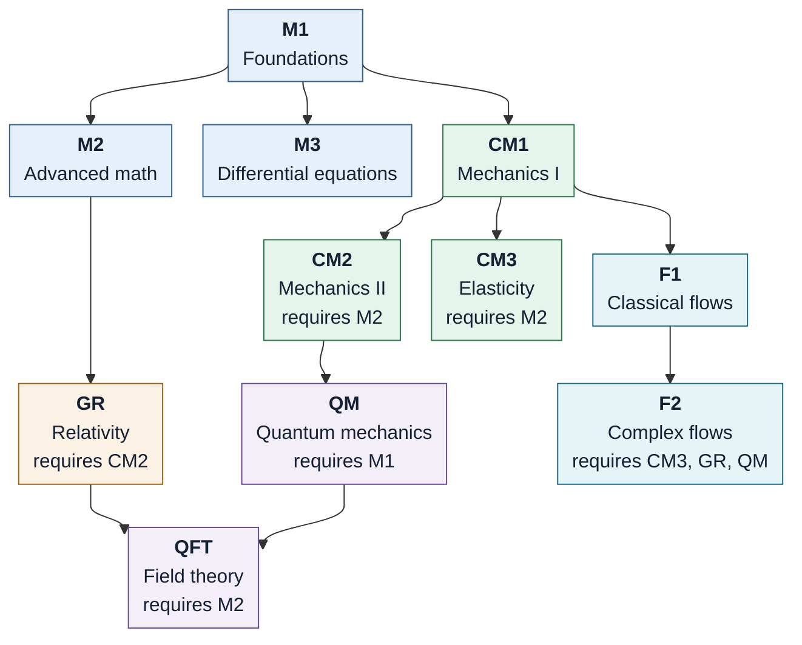

# Roadmap

Plan, status, dependencies and source placement for the eleven-document series. The syllabus of every document (the
chapter path from its entry level to its target level, with each chapter's prerequisites and status) is in
[CHAPTER_ORGANIZATION.md](CHAPTER_ORGANIZATION.md) and is not repeated here. Every moved file is listed in
[MIGRATION_LEDGER.md](MIGRATION_LEDGER.md); references between documents are audited in
[CROSS_REFERENCES.md](CROSS_REFERENCES.md); sources are registered in [sources_index.md](sources_index.md).

The tables in this file are generated by `tools/gen_docs.py` (template: `tools/ROADMAP.template.md`).

## Plan

The repository held one LaTeX book, `forms-tensors-ga/` (forms, tensors, geometric algebra, Stokes, curvature, the
residue theorem, and a physics chapter). It has been split into eleven documents plus a global glossary, by moving
whole files only.

| code | document | level |
|---|---|---|
| M1 | Mathematics I: Foundations | basics to undergraduate |
| M2 | Mathematics II: Advanced | graduate: tensors, geometric algebra, differential geometry, groups |
| M3 | Mathematics III: Differential Equations | undergraduate to postdoc/research |
| CM1 | Classical Mechanics I | basic Newton to 3D mechanics |
| CM2 | Classical Mechanics II | Lagrangian/Hamiltonian to postdoc, with modern mathematics (geometric algebra) |
| CM3 | Elasticity | zero to postdoc |
| F1 | Fluid Mechanics I: Classical Flows | Navier-Stokes to graduate |
| F2 | Fluid Mechanics II: Complex and Extreme Flows | graduate to postdoc |
| QM | Quantum Mechanics | zero to full quantum mechanics |
| QFT | Quantum Field Theory | quantum mechanics to postdoc |
| GR | General Relativity | zero to postdoc |
| GLOSSARY | Global glossary, identities and bibliography | reference document, consulted by all |

Rules that hold from now on:

1. **Move and reorder only.** No text is written, rewritten, summarised or deleted. The only edits allowed in moved
   files are structural (`\input` paths and `%!TEX root` lines); `tools/check_integrity.py` verifies this against
   the baseline commit `1dde429`.
2. **Simple to general.** Each document's chapters are ordered from simple to general; each present chapter prints
   a *Prerequisites* box (author-declared dependencies plus every earlier chapter it refers back to).
3. **Balance by moving whole chapters**, then by splitting at existing section boundaries; never by editing text.
4. **One owner per topic.** Other documents `\ref` the owner; references across documents resolve through
   `xr-hyper` and print the target document (`Section M2:4`, `(M1:13.1)`).
5. **One folder per document**: `chapters/`, `exercises/`, `figures/`, `sources/` (plus `backmatter/`, empty: back
   matter is owned by GLOSSARY).
6. **Missing content is marked**, never invented: `TODO(DOC/chNN)` chapters in the PDFs and in
   CHAPTER_ORGANIZATION.md.
7. **Symbols, terms, identities and the bibliography belong to GLOSSARY.** New ones from future sources are proposed
   here (see "Proposed source placements") and added to GLOSSARY, never to a chapter's back matter.

## Decisions taken

- **Content goes to its topical owner; the shortfall is reported, not forced.** About 90% of the existing text is
  mathematics, so M1 and M2 hold almost everything and the physics documents are mostly skeletons. Filling them
  needs new sources (see "Balance").
- **M1/M2 split.** M1 takes the algebra up to the exterior algebra, manifolds, tangent spaces, forms, and the
  integration theorems (Stokes, Gauss), because integration depends on the manifold chapters. M2 takes geometric
  algebra (Clifford algebra, multivector operations, rotors, duality and Hodge star), the Lie derivative, geometric
  calculus, the three synthesis chapters, connections and curvature, complex analysis, and the closing perspective.
- **Gauss classical corollaries moved to M2** (after Synthesis II): `sec:classical` needs the Hodge star and the
  Synthesis II dictionary, both owned by M2.
- **Physics section split by owner:** work and energy, pseudovectors (torque and the cross product), sources of
  confusion and the dictionary to CM1; energy as a contraction, Noether and Hamiltonian mechanics to CM2;
  circulation to F1; electromagnetism and the bridge to GR to GR. Pseudovectors was first planned for GR and placed
  in CM1 because its subject is torque; to move it, change `tools/structure_config.py` and rerun the tools.
- **Thermodynamics goes to `unsorted/`** (no owner document), with its figure.
- **Part headings:** existing part intros stay with their chapters. Where a run of chapters has no part heading in
  its new document (M2 parts I and II), the heading reads `TODO(M2/part-I)`, `TODO(M2/part-II)`. Physics chapters that
  lost their section heading read `TODO(CM2/ch02)`, `TODO(F1/ch05)`, `TODO(GR/ch03)`.
- **Bibliography:** one file, `GLOSSARY/references/references.tex`. Every document typesets it (with its label
  disabled outside GLOSSARY) so citations link inside each PDF; `\externaldocument[][nocite]` stops `xr-hyper`
  importing citation keys twice.
- **The unsorted material is buildable** (`unsorted/UNSORTED.tex`), so references to it resolve and show
  `Unsorted:...` until it gets a home.

## Document dependencies

An arrow points to the document read next. A box that names other codes requires those documents as well.
Color marks the subject: mathematics, classical mechanics, fluids, relativity, quantum theory. GLOSSARY is a
cross-cutting reference document and is not part of the reading order. Build order (used by
`tools/build_all.ps1`): M1, M2, M3, CM1, CM2, CM3, F1, GR, QM, F2, QFT, GLOSSARY, unsorted.

## Status

| document | folder | words | vs mean | +/-15% band | chapters present / planned | highest level present | target |
|---|---|---|---|---|---|---|---|
| M1 Mathematics I: Foundations | [M1-math-foundations/](M1-math-foundations/) | 16,698 | +388% | outside | 11 / 22 | graduate | undergraduate |
| M2 Mathematics II: Advanced | [M2-math-advanced/](M2-math-advanced/) | 17,366 | +408% | outside | 16 / 22 | postdoc/research | graduate (tensors, geometric algebra, differential geometry, groups) |
| M3 Mathematics III: Differential Equations | [M3-math-differential-equations/](M3-math-differential-equations/) | 0 | -100% | outside | 0 / 9 | none | postdoc/research |
| CM1 Classical Mechanics I | [CM1-classical-mechanics-1/](CM1-classical-mechanics-1/) | 1,649 | -52% | outside | 1 / 8 | undergraduate | 3D mechanics |
| CM2 Classical Mechanics II | [CM2-classical-mechanics-2/](CM2-classical-mechanics-2/) | 651 | -81% | outside | 1 / 10 | graduate | postdoc (modern mathematics, geometric algebra) |
| CM3 Elasticity | [CM3-elasticity/](CM3-elasticity/) | 0 | -100% | outside | 0 / 13 | none | postdoc |
| F1 Fluid Mechanics I: Classical Flows | [F1-fluids-classical/](F1-fluids-classical/) | 182 | -95% | outside | 1 / 12 | graduate | graduate |
| F2 Fluid Mechanics II: Complex and Extreme Flows | [F2-fluids-complex-extreme/](F2-fluids-complex-extreme/) | 0 | -100% | outside | 0 / 8 | none | postdoc |
| QM Quantum Mechanics | [QM-quantum-mechanics/](QM-quantum-mechanics/) | 0 | -100% | outside | 0 / 15 | none | full quantum mechanics |
| QFT Quantum Field Theory | [QFT-quantum-field-theory/](QFT-quantum-field-theory/) | 0 | -100% | outside | 0 / 13 | none | postdoc |
| GR General Relativity | [GR-general-relativity/](GR-general-relativity/) | 1,055 | -69% | outside | 2 / 13 | graduate | postdoc |

Mean over the eleven documents: 3,418 words; band 2,906 to 3,931. GLOSSARY: 5,757 words (reference document, outside the balance rule). Unsorted: 1,364 words.

M1 and M2 against their shared mean (17,032): M1 -2.0%, M2 +2.0%.

## Balance

The +/-15% band around the eleven-document mean cannot be met by moving existing text: the physics documents (CM1, CM2,
F1, GR) hold only the short pieces of the old physics chapter, and M3, CM3, F2, QM and QFT have no content at all. No
text has been written to compensate. M1 and M2, which hold almost all existing text, are balanced against each other
(see the line under the status table); no section split was needed. The gap closes as sources fill the TODO chapters
of CHAPTER_ORGANIZATION.md; when a document grows past the band, whole chapters move first, then existing section
files.

## Topic ownership

| owner | topics present |
|---|---|
| M1 | vectors and covectors, tensors, metric, exterior algebra and interior product, manifolds, tangent and cotangent spaces, tensor fields and the exterior derivative, integration of 1-forms and k-forms, Stokes, Gauss |
| M2 | Clifford algebra, multivector operations, rotors, duality and Hodge star, Lie derivative, geometric calculus, classical vector-calculus corollaries, connections, Levi-Civita, Riemann curvature, geodesic deviation, residue theorem, the current state of the subject, master summary |
| CM1 | intrinsic versus metric quantities, work and energy as forms, pseudovectors and torque, physics-to-geometry dictionary |
| CM2 | energy as a contraction (Legendre), Noether and Killing fields, action and Hamiltonian mechanics |
| F1 | circulation and Kelvin's theorem |
| GR | electromagnetism as forms, bridge to general relativity (Einstein's equations preview) |
| GLOSSARY | symbols, terms, identities with proofs, bibliography |
| M3, CM3, F2, QM, QFT | none yet |

## Soft prerequisites (forward references)

References that point to material read later (a later document, or a document that is not upstream). They are kept
exactly as written; the reader can follow the link. Full list with file and line: [CROSS_REFERENCES.md](CROSS_REFERENCES.md).

| from chapter | refers forward to | refs |
|---|---|---|
| CM1/ch03 | CM2/ch02 | 1 |
| CM1/ch03 | M2/ch04 | 1 |
| F1/ch05 | M2/ch07 | 1 |
| M1/00-part-algebra | M2/ch01 | 1 |
| M1/00-part-algebra | M2/ch04 | 1 |
| M1/ch06 | M2/ch02 | 1 |
| M1/ch06 | M2/ch05 | 1 |
| M1/ch08 | CM1/ch03 | 1 |
| M1/ch08 | GR/ch04 | 1 |
| M1/ch08 | M2/ch01 | 1 |
| M1/ch08 | M2/ch04 | 1 |
| M1/ch08 | M2/ch08 | 2 |
| M1/ch09 | CM1/ch03 | 1 |
| M1/ch09 | GR/ch03 | 1 |
| M1/ch09 | M2/ch02 | 1 |
| M1/ch09 | M2/ch04 | 2 |
| M1/ch09 | M2/ch05 | 2 |
| M1/ch09 | M2/ch07 | 1 |
| M1/ch09 | M2/ch09 | 1 |
| M1/ch11 | CM1/ch03 | 1 |
| M1/ch11 | M2/ch10 | 1 |
| M1/ch12 | M2/ch04 | 1 |
| M1/ch12 | M2/ch07 | 1 |
| M1/ch12 | M2/ch14 | 1 |
| M1/ch14 | M2/ch04 | 1 |
| M1/ch14 | M2/ch09 | 1 |
| M1/ch16 | M2/ch07 | 1 |
| M2/ch07 | F1/ch05 | 1 |
| M2/ch09 | GR/ch03 | 1 |
| M2/ch14 | CM1/00-part-physics | 1 |
| M2/ch14 | CM2/ch02 | 1 |
| M2/ch17 | CM1/ch03 | 1 |
| M2/ch17 | GR/ch03 | 1 |

## Missing content

Every TODO chapter, by document (details, levels and prerequisites in [CHAPTER_ORGANIZATION.md](CHAPTER_ORGANIZATION.md)):

- **M1**: `TODO(M1/ch01)` Numbers, complex numbers, sets and functions, `TODO(M1/ch02)` Calculus of one variable, `TODO(M1/ch03)` Linear algebra: matrices, determinants, eigenvalues, `TODO(M1/ch04)` Multivariable and vector calculus in three dimensions: gradient, divergence, curl, line and surface integrals, and the classical theorems of Green, Stokes and Gauss, `TODO(M1/ch05)` Ordinary differential equations, `TODO(M1/ch17)` Fourier series, Fourier and Laplace transforms, `TODO(M1/ch18)` Partial differential equations of physics: separation of variables, special functions and Green's functions, `TODO(M1/ch19)` Calculus of variations, `TODO(M1/ch20)` Probability, statistics and random processes, `TODO(M1/ch21)` Numerical methods: quadrature, ODE solvers, linear systems and finite differences, `TODO(M1/ch22)` Complex analysis: analytic functions, Cauchy's theorem, Laurent series, residues and conformal maps
- **M2**: `TODO(M2/ch06)` Groups: symmetry, finite groups and representations, `TODO(M2/ch15)` Lie groups and Lie algebras, `TODO(M2/ch16)` Fibre bundles, gauge connections and spinors, `TODO(M2/ch18)` Hilbert spaces, distributions and spectral theory, `TODO(M2/ch19)` Stochastic processes and statistical methods, `TODO(M2/ch22)` Topology: homotopy, homology and de Rham cohomology
- **M3**: `TODO(M3/ch01)` Ordinary differential equations: existence and uniqueness, linear systems, Floquet theory and Sturm-Liouville problems, `TODO(M3/ch02)` Dynamical systems: phase portraits, stability, bifurcations and chaos, `TODO(M3/ch03)` Asymptotic and perturbation methods: regular and singular perturbations, matched asymptotics, multiple scales, WKB, `TODO(M3/ch04)` Partial differential equations: classification, characteristics, first-order equations and well-posedness, `TODO(M3/ch05)` Elliptic and parabolic equations: Green's identities, maximum principles, Green's functions and the heat kernel, `TODO(M3/ch06)` Hyperbolic equations and conservation laws: wave equation, shocks, the Riemann problem and the Cauchy problem, `TODO(M3/ch07)` Weak solutions, Sobolev spaces and variational formulations, `TODO(M3/ch08)` Nonlinear PDEs: dispersive waves, solitons, and the mathematical theory of the Euler and Navier-Stokes equations, `TODO(M3/ch09)` Numerical methods for PDEs: finite differences, finite volumes, finite elements, spectral methods, stability and convergence
- **CM1**: `TODO(CM1/ch01)` Kinematics in one and three dimensions, `TODO(CM1/ch02)` Newton's laws, forces and free-body problems, `TODO(CM1/ch04)` Work, energy, momentum and conservation laws; collisions and systems of particles, `TODO(CM1/ch05)` Oscillations: free, damped, driven and coupled (normal modes), `TODO(CM1/ch06)` Central forces, Kepler orbits, gravitation and scattering, `TODO(CM1/ch07)` Non-inertial reference frames, `TODO(CM1/ch08)` Rigid-body motion in 3D: inertia tensor and Euler equations
- **CM2**: `TODO(CM2/ch01)` Constraints, variational principles and Lagrangian mechanics (including small oscillations), `TODO(CM2/ch03)` Symplectic geometry, Poisson brackets and Hamiltonian flows, `TODO(CM2/ch04)` Canonical transformations and Hamilton-Jacobi theory, `TODO(CM2/ch05)` Integrable systems, action-angle variables, perturbation theory, KAM and chaos, `TODO(CM2/ch06)` Rigid bodies and rotors in geometric algebra, `TODO(CM2/ch07)` Spacetime algebra and relativistic mechanics, `TODO(CM2/ch08)` Geometric mechanics: Lie groups, momentum maps and reduction, `TODO(CM2/ch09)` Classical field theory: Lagrangian densities and Noether currents, `TODO(CM2/ch10)` Multisymplectic and covariant formulations
- **CM3**: `TODO(CM3/ch01)` Stress, strain and Hooke's law in one dimension, `TODO(CM3/ch02)` Kinematics of deformation: displacement and the strain tensor, `TODO(CM3/ch03)` The Cauchy stress tensor and equilibrium, `TODO(CM3/ch04)` Linear isotropic elasticity: Navier-Cauchy equations, `TODO(CM3/ch05)` Classical problems: torsion, bending, plane elasticity, `TODO(CM3/ch06)` Beams, plates, shells and buckling, `TODO(CM3/ch07)` Elastic waves, `TODO(CM3/ch08)` Energy methods and variational principles, `TODO(CM3/ch09)` Anisotropic elasticity and composites, `TODO(CM3/ch10)` Finite (nonlinear) elasticity, `TODO(CM3/ch11)` Plasticity, viscoelasticity, thermoelasticity and fracture, `TODO(CM3/ch12)` Finite element methods for solids, `TODO(CM3/ch13)` Geometric elasticity: defects, incompatibility and Riemann-Cartan geometry
- **F1**: `TODO(F1/ch01)` Continuum hypothesis and kinematics of flow, `TODO(F1/ch02)` Conservation laws: mass, momentum, energy, `TODO(F1/ch03)` The Navier-Stokes equations and constitutive relations, `TODO(F1/ch04)` Ideal flow: Euler equations and Bernoulli, `TODO(F1/ch06)` Potential flow and complex potentials, `TODO(F1/ch07)` Viscous flows: exact solutions, Stokes flow, lubrication, `TODO(F1/ch08)` Boundary layers, `TODO(F1/ch09)` Hydrodynamic stability, `TODO(F1/ch10)` Introduction to turbulence, `TODO(F1/ch11)` Compressible flow and gas dynamics, `TODO(F1/ch12)` Waves in fluids
- **F2**: `TODO(F2/ch01)` Turbulence: advanced theory and extensions, `TODO(F2/ch02)` Non-Newtonian and complex fluids, `TODO(F2/ch03)` Temperature-dependent flows: convection and variable properties, `TODO(F2/ch04)` Multifluid flows: mixing and unmixing, `TODO(F2/ch05)` Plasma: magnetohydrodynamics and kinetic theory, `TODO(F2/ch06)` Relativistic fluids: special-relativistic flows and fluids in curved spacetime, `TODO(F2/ch07)` Quantum fluids: superfluids and Bose-Einstein condensates, `TODO(F2/ch08)` Numerical methods for fluids
- **QM**: `TODO(QM/ch01)` Experimental origins of quantum theory, `TODO(QM/ch02)` Wave mechanics and the Schrodinger equation, `TODO(QM/ch03)` One-dimensional problems, `TODO(QM/ch04)` Hilbert spaces, Dirac notation and the postulates, `TODO(QM/ch05)` The harmonic oscillator, `TODO(QM/ch06)` Angular momentum and spin, `TODO(QM/ch07)` The hydrogen atom, `TODO(QM/ch08)` Identical particles, atoms and molecules, `TODO(QM/ch09)` Approximation methods: perturbation theory, variational, WKB, `TODO(QM/ch10)` Time-dependent perturbation theory and transitions, `TODO(QM/ch11)` Scattering theory, `TODO(QM/ch12)` Symmetries in quantum mechanics, `TODO(QM/ch13)` Density matrices, entanglement, measurement and open quantum systems, `TODO(QM/ch14)` Path integrals, `TODO(QM/ch15)` Relativistic quantum mechanics: Klein-Gordon and Dirac
- **QFT**: `TODO(QFT/ch01)` Lorentz group and its representations, `TODO(QFT/ch02)` Classical field theory, `TODO(QFT/ch03)` Canonical quantisation of free fields, `TODO(QFT/ch04)` Interacting fields, the S-matrix and Feynman diagrams, `TODO(QFT/ch05)` Quantum electrodynamics, `TODO(QFT/ch06)` Path-integral quantisation, `TODO(QFT/ch07)` Renormalisation, the renormalisation group and effective field theory, `TODO(QFT/ch08)` Non-abelian gauge theories, `TODO(QFT/ch09)` Spontaneous symmetry breaking and the Higgs mechanism, `TODO(QFT/ch10)` The Standard Model, `TODO(QFT/ch11)` Anomalies, instantons and topology, `TODO(QFT/ch12)` Quantum field theory in curved spacetime, `TODO(QFT/ch13)` Conformal field theory and research frontiers
- **GR**: `TODO(GR/ch01)` Special relativity, `TODO(GR/ch02)` Minkowski spacetime and tensors on spacetime, `TODO(GR/ch05)` The Einstein field equations, `TODO(GR/ch06)` The Schwarzschild solution and classical tests, `TODO(GR/ch07)` Black holes: horizons, charged and rotating solutions, `TODO(GR/ch08)` Gravitational waves, `TODO(GR/ch09)` Cosmology, `TODO(GR/ch10)` Hamiltonian (ADM) formulation and numerical relativity, `TODO(GR/ch11)` Tetrads, spinors and gauge-theory gravity in geometric algebra, `TODO(GR/ch12)` Causal structure and singularity theorems, `TODO(GR/ch13)` Black hole thermodynamics and Hawking radiation
- **GLOSSARY**: `TODO(GLOSSARY/M3)`, `TODO(GLOSSARY/CM1)`, `TODO(GLOSSARY/CM2)`, `TODO(GLOSSARY/CM3)`, `TODO(GLOSSARY/F1)`, `TODO(GLOSSARY/F2)`, `TODO(GLOSSARY/QM)`, `TODO(GLOSSARY/QFT)`, `TODO(GLOSSARY/GR)` (no symbols, terms or identities yet for these documents).

## Unsorted

`unsorted/` holds what fits no document:

- `thermodynamics/05-thermodynamics.tex` and `thermodynamics/figures/tikz-cycle.tex` (thermodynamics as forms; no
  thermodynamics document exists);
- `frontmatter/` (title, abstract and reading guide of the old single book);
- `legacy/` (`original.tex`/`original.pdf`, the old root `main.tex` and `latexmkrc`, and the root
  `forms_tensors_geometric_algebra_unified.tex`);
- `project-docs/` (old README, provenance table, author notes, baseline, rewrite plan);
- `legacy-build/` (old build outputs, including the old `main.pdf`).

## Proposed source placements

Sources are added to a document's `sources/` folder and registered in [sources_index.md](sources_index.md). Before
anything is merged, the placement is proposed here and approved.

| source ID | file | owner document | CHAPTER_ORGANIZATION.md row it would fill | glossary additions | status |
|---|---|---|---|---|---|
| (none yet) | | | | | |

## Tools

| command | does |
|---|---|
| `tools/build_all.ps1` | builds the 13 PDFs in dependency order until stable, then runs `tools/check_xrefs.py` |
| `python tools/check_xrefs.py` | label, reference, citation, link and prerequisite checks; writes CROSS_REFERENCES.md |
| `python tools/check_integrity.py` | proves the move-only rule against the baseline commit |
| `python tools/wordcount.py` | per-document word counts and the +/-15% band |
| `python tools/xref_graph.py` | chapter-level dependency graph from actual `\ref` usage |
| `python tools/restructure.py scaffold` | regenerates every `main.tex` from `tools/structure_config.py` |
| `python tools/gen_docs.py` | regenerates this file's tables, CHAPTER_ORGANIZATION.md, MIGRATION_LEDGER.md, sources_index.md |
